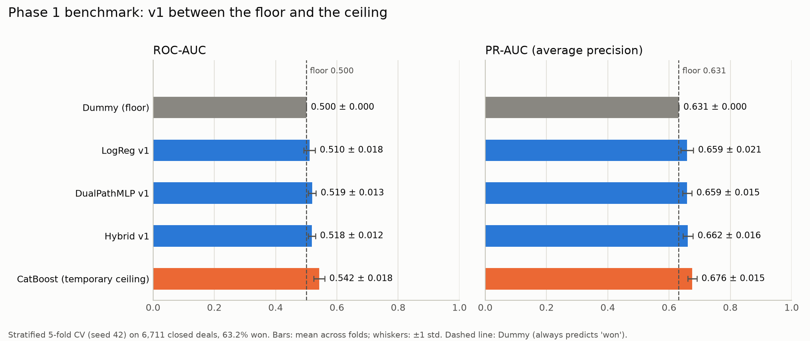

# Predictive Sales Pipeline

This project predicts whether a closed B2B sales opportunity was **won or lost**, using account, product and sales-team attributes. The data is Maven Analytics' *CRM Sales Opportunities* dataset.

The v1 system has three parts:
- a Logistic Regression
- a dual-path neural network (`DualPathMLP`)
- a 40/60 blend of the two (the Hybrid)

Phase 1 adds an honest benchmark. It places v1 between a do-nothing floor and a strong off-the-shelf ceiling.

## Benchmark (Phase 1)

How the benchmark is run:
- Stratified 5-fold cross-validation (seed 42) on all 6,711 closed deals.
- Every preprocessing step is fit inside the training fold.
- Anything tuned (MLP early stopping, the Hybrid's threshold) uses an inner validation split of the training fold. The test fold is only used for scoring.
- Every model uses the same saved folds.

**Class balance:** 4,238 won and 2,473 lost, so **63.2% won**. A model that predicts "won" for every deal already scores F1 0.774, precision 0.632 and accuracy 0.632.



| Model | ROC-AUC | PR-AUC | F1 @0.5 | Precision @0.5 | Recall @0.5 | Accuracy @0.5 | Brier ↓ | Predicted "won" @0.5 |
| --- | --- | --- | --- | --- | --- | --- | --- | --- |
| Dummy (floor) | 0.500 ± 0.000 | 0.632 ± 0.000 | 0.774 ± 0.000 | 0.632 ± 0.000 | 1.000 ± 0.000 | 0.632 ± 0.000 | 0.368 ± 0.000 | 100% |
| LogReg v1 | 0.510 ± 0.018 | 0.659 ± 0.021 | 0.518 ± 0.026 | 0.640 ± 0.015 | 0.436 ± 0.030 | 0.489 ± 0.018 | 0.250 ± 0.003 | 43% |
| DualPathMLP v1 | 0.519 ± 0.013 | 0.659 ± 0.015 | 0.749 ± 0.012 | 0.629 ± 0.004 | 0.927 ± 0.032 | 0.608 ± 0.012 | 0.237 ± 0.002 | 93% |
| Hybrid v1 | 0.518 ± 0.012 | 0.662 ± 0.016 | 0.735 ± 0.017 | 0.630 ± 0.002 | 0.881 ± 0.045 | 0.599 ± 0.015 | 0.238 ± 0.002 | 88% |
| CatBoost (temporary ceiling) | 0.542 ± 0.018 | 0.676 ± 0.015 | 0.772 ± 0.001 | 0.632 ± 0.001 | 0.994 ± 0.002 | 0.630 ± 0.001 | 0.232 ± 0.002 | 99% |

How to read the table:
- Each cell is the mean ± std over the 5 folds.
- Brier: lower is better. A constant forecast of 63.2% scores 0.233. The Dummy forecasts 100% for every deal, so it scores 0.368.
- **Hybrid v1 with a tuned threshold:** the threshold is picked on the inner validation split, from v1's grid of 0.3–0.7. It lands on 0.3 or 0.4 in every fold and gives F1 0.774 ± 0.000, the same as predicting "won" for every deal.

**Where v1 sits**

- **At the floor.** v1 scores ROC-AUC 0.510–0.519, against 0.500 for the Dummy. The MLP and the Hybrid beat 0.5 in all 5 folds, but only by 0.008–0.038. LogReg falls below 0.5 in 2 of the 5 folds.
- **Its F1 comes from predicting "won".** The Dummy has the best F1 at threshold 0.5. The MLP and the Hybrid predict "won" for 93% and 88% of deals. Tuning the Hybrid's threshold for F1 makes it predict "won" for almost everyone. v1's probabilities are also less accurate than a constant 63.2% forecast (Brier 0.237–0.250 vs 0.233).
- **The ceiling is low as well.** CatBoost with default settings reaches only 0.542 ROC-AUC. It beats the MLP and the Hybrid in all 5 folds, and LogReg in 4 of 5, but only by a small margin. The 14 v1 features carry little signal, so the next step is better features, not a bigger model.

> **Ceiling note.** The planned ceiling is TabPFN with default settings. Its 3.5 weights are in a gated Hugging Face repo, and this machine isn't logged in for it yet. Until then, CatBoost with default settings is the ceiling, labelled "temporary ceiling". To add TabPFN:
> 1. Accept the terms at <https://huggingface.co/Prior-Labs/tabpfn_3_5>.
> 2. Run `hf auth login` (or set `HF_TOKEN`).
> 3. Rerun the benchmark without `--ceiling`. It reuses the same saved folds.

**Run it** (about 30 s on an M2 CPU with CatBoost):

```bash
python -m src.benchmark --out results/benchmark_v1.csv --ceiling catboost
python -m src.benchmark --check-v1   # checks the benchmark reproduces v1's original numbers exactly
```

Outputs in `results/`:

- `benchmark_v1.csv`: one row per fold × model
- `benchmark_v1_summary.csv`: mean and std per model
- `benchmark_v1_folds.csv`: the fold of every row. Later phases reuse it, and the run stops if the folds ever change.
- `benchmark_v1_env.json`: Python, platform and package versions
- `figures/benchmark_v1_ladder.png`: the chart above

Two runs from start to finish produce byte-identical files.

## Setup

Requires Python 3.12 (TabPFN needs 3.10 or newer). Run every command from the project root, because `process_data.py` uses relative paths.

**1. Get the data.** Download Maven Analytics' *CRM Sales Opportunities* dataset. Put `accounts.csv`, `products.csv`, `sales_pipeline.csv` and `sales_teams.csv` in `data/raw/`. The folder is gitignored.

**2. Create the environment.**

```bash
python3.12 -m venv .venv
source .venv/bin/activate
python -m pip install -r requirements.txt
```

**3. Run.**

```bash
python -m src.process_data                     # data/raw -> data/processed/processed_sales_data.csv
python -m src.benchmark --ceiling catboost     # Phase 1 benchmark (~30 s)
python main.py                                 # v1 single-split pipeline (~5 s); rewrites the v1 files in results/
```

If the processed file is missing, both `main.py` and the benchmark build it automatically.

## Project structure

```text
AML_DL--Project/
├── data/                              # not in git
│   ├── raw/                           # the four Maven CSVs (+ data_dictionary.csv)
│   └── processed/
│       └── processed_sales_data.csv   # 6,711 closed deals
├── notebook/
│   ├── 01_EDA.ipynb
│   ├── 02_Modeling.ipynb
│   └── archive/                       # leaky experiments, history only
├── reports/                           # course reports (PDF)
├── results/                           # metrics and charts; Phase 1 outputs are benchmark_v1*
│   └── figures/
├── src/
│   ├── process_data.py                # raw CSVs -> processed table
│   ├── phase3_pipeline.py             # v1 models and single-split analysis (run by main.py)
│   └── benchmark.py                   # Phase 1 cross-validated benchmark
├── main.py                            # runs the v1 pipeline
├── requirements.txt                   # exact versions used
├── PHASE1_PLAN.md                     # Phase 1 analysis and plan
└── Readme.md
```

## Data and target

- The raw pipeline has 8,800 opportunities. The 2,089 still open (Engaging, Prospecting) are dropped because their outcome is unknown. That leaves **6,711 closed deals**, with target = 1 for Won.
- Accounts, products and sales teams are joined in with left joins.
- **Known data issue.** The pipeline names a product `GTXPro`, but the products table calls it `GTX Pro`. As a result, 1,147 deals (17%) get `series = "Unknown"` and a median `sales_price`, and that median is computed before any split. Phase 1 keeps this as-is; Phase 2 fixes it.

## v1 models

**Features (14).**
- Numeric: `year_established, revenue, employees, sales_price, engage_year, engage_month, log_revenue, log_employees`.
- Categorical: `sector, product, manager, office_location, regional_office, series`.
- Deliberately excluded: `close_value` (0 for every lost deal), plus `deal_duration_days`, `close_year` and `close_month` (only known after a deal closes).

**LogReg.** `StandardScaler` + `OneHotEncoder` feeding `LogisticRegression(class_weight="balanced")`.

**DualPathMLP.** Written in NumPy, with hand-written backprop and Adam. Each path is fit on the training data only.

```text
Numeric path (8 features)          Categorical path (6 features)
StandardScaler                     OneHotEncoder (45 columns)
Dense(16, ReLU)                    Dense(32, ReLU)
          \                          /
           +------ concat (48) -----+
                      |
               Dense(64, ReLU)
               Dense(32, ReLU)
               Dense(1, sigmoid)  ->  P(won)
```

Training setup:
- Loss: binary cross-entropy + L2 (α = 0.001).
- Optimiser: Adam, learning rate 0.001, batch size 128.
- Up to 220 epochs, with early stopping (patience 20) on an inner 20% validation split of the training data.

**Hybrid.** `0.4 × LogReg + 0.6 × DualPathMLP` probabilities.

## Reproducibility

- Seed 42 everywhere. The benchmark also seeds `random`, NumPy and torch, and turns on deterministic torch kernels.
- The folds are saved in `results/benchmark_v1_folds.csv`, versions are logged in `results/benchmark_v1_env.json`, and `requirements.txt` pins exact versions.
- v1's original single-split numbers reproduce exactly on these library versions (`python -m src.benchmark --check-v1`).

## v1 results (single 80/20 split, superseded)

> **Superseded:** one 80/20 split, a threshold picked on the test set and no baseline. The benchmark above replaces these numbers. For example, the "optimal threshold 0.3" below is just the always-"won" classifier: F1 = 2p/(1+p) = 0.774.

### Outputs of `python main.py`

1. **Model comparison**: `hybrid_model_comparison.csv` (Setup, F1, Precision, Recall, ROC-AUC, False Positives, False Negatives, Threshold) and `hybrid_vs_ml_vs_dl_grouped_metrics.png`.
2. **Ablation study**: `ablation_study_metrics.csv` and `ablation_study_grouped_bar_chart.png`. Finding: removing DL reduces recall by 59.2%, removing ML increases false positives by 4.3%, so both are necessary.
3. **Threshold optimisation**: `threshold_analysis.csv` (thresholds 0.3–0.7) and `threshold_analysis_hybrid.png`. Optimal: 0.3 (F1 0.774, recall 1.0).
4. **SHAP explainability**: `shap_summary_top10_ml.png`, `shap_top10_features_ml.csv` and `shap_business_interpretation.txt`.
5. **Error segmentation**: `error_segmentation_by_category.png` and `error_segmentation_summary.csv`, covering sector (10), product (7) and price quartile (4). Finding: the model struggles most with mid-price deals ($1,096–$3,393), at a 46.8% error rate.
6. **Architecture diagram**: `architecture_diagram.png`.

### Overall performance (threshold 0.5)

| Model   | F1    | Precision | Recall | ROC-AUC |
| ------- | ----- | --------- | ------ | ------- |
| Hybrid  | 0.745 | 0.628     | 0.916  | 0.520   |
| DL-only | 0.766 | 0.632     | 0.973  | 0.521   |
| ML-only | 0.473 | 0.643     | 0.374  | 0.514   |

### Top 5 predictive features (by SHAP impact)

1. **log_employees** (0.095): decreases the score at higher values
2. **engage_year** (0.080): timing of engagement matters
3. **year_established** (0.075): company maturity influence
4. **log_revenue** (0.057): increases the score at higher values
5. **office_location_Panama** (0.024): geographic advantage

### Best and worst performing segments

| Category | Best segment | Error rate | Worst segment     | Error rate |
| -------- | ------------ | ---------- | ----------------- | ---------- |
| Sector   | Marketing    | 29.3%      | Services          | 45.6%      |
| Product  | GTK 500      | 0%\*       | MG Advanced       | 46.8%      |
| Price    | Low ($0–550) | 37.1%      | Mid ($1.1K–$3.4K) | 46.8%      |

\*GTK 500: only 3 deals.

### Original reproducibility notes

- Data split: stratified 80/20 train/test split, random state 42.
- Preprocessing: "fitted only on training data (prevents leakage)". Not quite true: the `sales_price` median is computed before the split, and the threshold was picked on the test set.
- Validation: early stopping with patience 20 on the DL model, using a validation split of the training data.
- Dataset size was listed as 1,343 rows. That is the test split; the dataset has 6,711 rows.

## License

Proprietary - Predictive Sales Project
